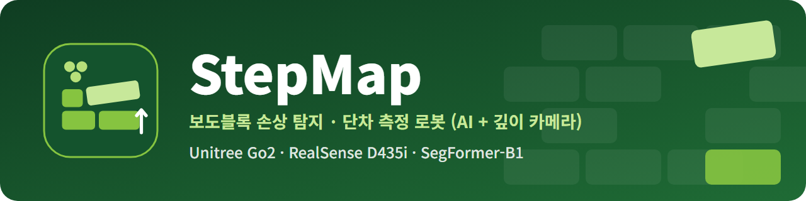
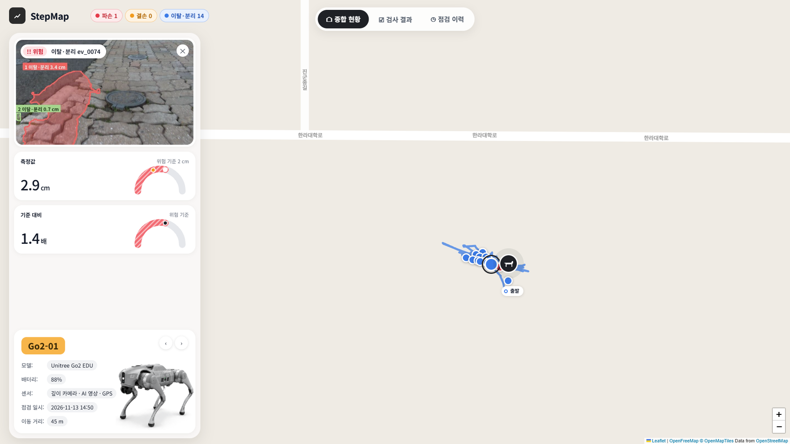
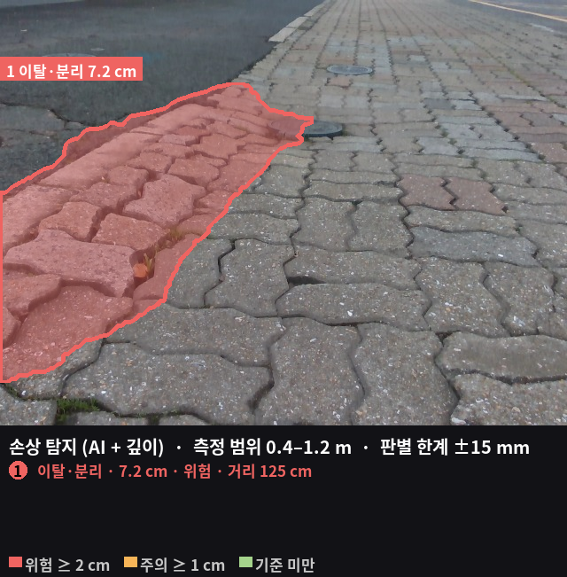
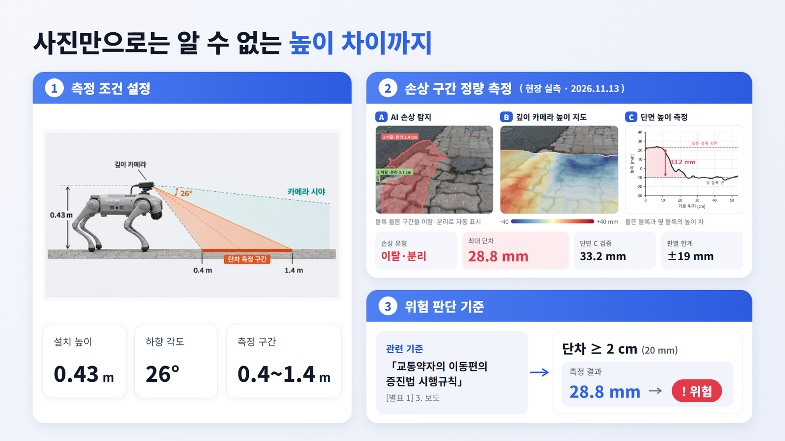
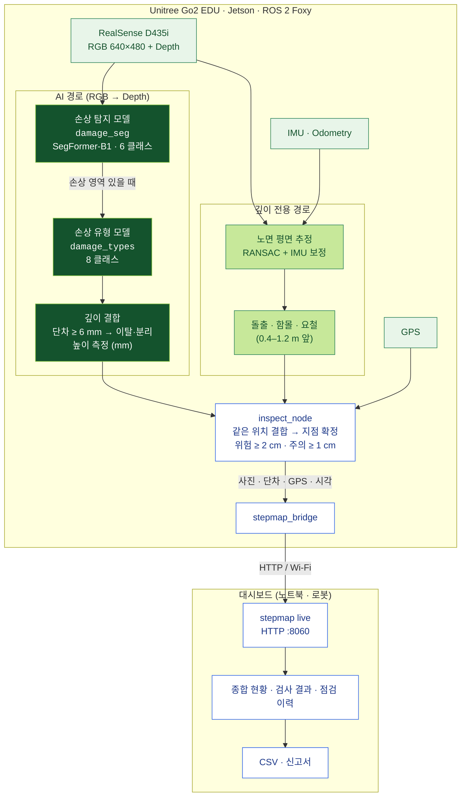
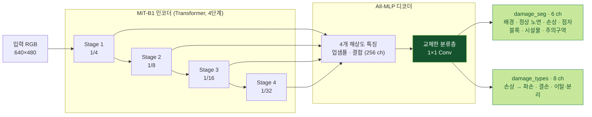

<p align="center">
  
</p>

<p align="center">
  
  
  
  
  
</p>

<p align="center">
  <b>보도블록의 파손·결손·이탈·분리를 사족보행 로봇으로 찾아내고, 깊이 카메라로 단차를 재서 지도에 기록합니다.</b><br>
  Unitree Go2 · Intel RealSense D435i · SegFormer-B1 · ROS 2 Foxy
</p>

---

## StepMap이란

보행 약자에게 위험한 **보도블록 단차**는 사진만으로는 높이를 알 수 없습니다.
StepMap은 사족보행 로봇 Go2가 보도를 걸으며 손상을 찾고, **몇 mm 솟았는지·꺼졌는지**를 재서 지도에 남깁니다.

| 탐지 | 측정 | 기록 |
|:---:|:---:|:---:|
| AI(SegFormer-B1)가 RGB 영상에서 **파손 · 결손 · 이탈·분리** 영역을 픽셀 단위로 탐지 | 깊이 카메라로 노면 평면을 추정하고 손상 부위의 **단차(mm)** 를 측정 → **위험 ≥ 2 cm · 주의 ≥ 1 cm** | 사진 · GPS · 시각과 함께 **대시보드 지도**에 실시간 표시, **CSV** 로 내보내기 |

| 대시보드 (2026-11-13 현장 실측) | 로봇 카메라 · AI 손상 탐지 |
|---|---|
|  |  |

<p align="center"><br><sub>AI 탐지 → 깊이 카메라 높이 지도 → 단면에서 단차 측정 (현장 실측)</sub></p>

## 시스템 아키텍처



**두 경로가 병렬로 동작합니다.**
- **AI 경로** — RGB가 *어디가, 어떤 유형으로* 손상됐는지 찾고, 깊이가 그 자리의 *높이 차이* 를 재서 유형(이탈·분리)과 위험도를 확정합니다.
- **깊이 전용 경로** — AI가 놓쳐도 노면보다 솟거나 꺼진 곳(돌출·함몰)을 따로 측정합니다.

## 저장소 구성

| 폴더 | 내용 |
|---|---|
| [`robot/`](robot) | Go2에서 실행되는 ROS 2 노드: 센서, AI 손상 탐지(`surface_seg_node.py`, `damage_ai.py`), 지점 확정(`inspect_node.py`), 대시보드 전송(`stepmap_bridge.py`), 실행 launch |
| [`dashboard/`](dashboard) | 대시보드 (`python -m stepmap live`): 종합 현황 · 검사 결과 · 점검 이력 · CSV · 신고서 |
| [`training/`](training) | SegFormer-B1 학습 · 파인튜닝 · 평가 · ONNX 내보내기 |
| [`models/`](models) | Go2 탑재 ONNX 모델 안내 (파일은 Releases) |
| [`examples/`](examples) | 2026-11-13 현장 실측 데이터 (15개 지점 · 로봇 사진) |

## 모델

**SegFormer-B1** (NVIDIA) 을 픽셀 단위 손상 분할에 사용합니다. 새 층을 추가하지 않고 **디코더의 마지막 분류층(1×1 Conv)만 교체**했습니다.



| 단계 | 데이터 | 분류층 출력 |
|---|---|---|
| 사전학습 | ImageNet-1K → ADE20K (NVIDIA 공개 가중치) | 150 클래스 |
| 1차 학습 | AI Hub 「인도보행 영상」 서피스마스킹 (RGB 1920×1080, 폴리곤 → 픽셀 마스크) | **6 클래스** |
| 파인튜닝 (탐지) | + Go2 · 스마트폰 현장 사진 (픽셀 라벨 검수·수정), 배치의 50%는 AI Hub 유지 | 6 클래스 → `damage_seg.onnx` |
| 파인튜닝 (유형) | 손상 채널을 **파손 · 결손 · 이탈·분리** 3채널로 분리, 기존 손상 가중치로 초기화 | **8 클래스** → `damage_types.onnx` |


Go2(Jetson)에서는 두 모델을 **TensorRT FP16** 으로 변환해 실시간 실행합니다.

### 성능

Go2 탑재 손상 탐지 모델의 **재현율(Recall)** 입니다. 두 모델 모두 학습하지 않은 **Go2 사진 200장 (손상 33장)** 으로 평가했습니다.
유형별 재현율 = 해당 유형으로 라벨된 사진 중 모델이 손상 영역을 찾아낸 비율.

| 손상 유형 | 개선 전 (AI Hub만 학습) | 개선 후 (현장 데이터 파인튜닝) | 개선 폭 |
|---|---|---|---|
| 파손 (21장) | 38.1% | **85.7%** | +47.6%p |
| 결손 (9장) | 22.2% | **77.8%** | +55.6%p |
| 이탈·분리 (15장) | 26.7% | **46.7%** | +20.0%p |
| **Average Recall** (3개 유형 평균) | 29.0% | **70.1%** | +41.1%p |
| 전체 손상 사진 기준 (33장) | 27.3% (9/33) | **63.6%** (21/33) | +36.3%p |

개선 후 정밀도(Precision) 87.5%, 정확도(Accuracy) 92.5%.

**표 읽는 법**

- **평가 사진**: 학습에 한 번도 쓰지 않은 Go2 사진 200장(손상 33장 · 정상 167장)으로만 평가했습니다. 개선 전·후 두 모델 모두 같은 사진으로 비교했습니다.
- **재현율(Recall)**: 실제 손상 사진 중 모델이 손상을 찾아낸 비율입니다. 예) 파손 사진 21장 중 18장을 찾으면 85.7%.
- **Average Recall 70.1%**: 파손 · 결손 · 이탈·분리 세 유형의 재현율을 같은 비중으로 평균한 값입니다.
- **전체 손상 사진 기준 63.6%**: 유형을 나누지 않고 손상 사진 33장을 한꺼번에 세어 21장을 찾은 값입니다. 이탈·분리 사진(15장)이 많고 재현율이 낮아 평균보다 낮게 나옵니다.
- **정밀도 87.5%**: 모델이 "손상"이라고 알린 24장 중 21장이 실제 손상이었습니다 (잘못 알림 3장).
- **정확도 92.5%**: 200장 전체에서 손상/정상을 맞게 판정한 비율입니다.

> 이탈·분리는 사진만으로 정상 블록과 구분이 어려워, 실제 시스템에서는 **깊이 카메라의 단차**로 판정합니다.

## 빠르게 실행해 보기

```bash
cd dashboard
pip install -e .
python -m stepmap map ../examples/session_20261113/events.csv ../examples/session_20261113/trajectory.csv -o out/dashboard.html
```

로봇 실행은 [`robot/README.md`](robot/README.md), 학습은 [`training/README.md`](training/README.md) 를 참고하세요.

## 팀

| 이름 | GitHub | 맡은 일 |
|---|---|---|
| 홍윤재 | [@yoonjae26](https://github.com/yoonjae26) | 서버 · 데이터 연동, 점검 결과 저장 · 관리, 백엔드 시스템 구현 |
| 한가원 | [@hangawon](https://github.com/hangawon) | 프로젝트 기획 · 개발 총괄, 현장 데이터 구축 · 라벨 검수, AI 모델 개선 · 성능 검증 |
| 강윤희 | [@kangyh2674](https://github.com/kangyh2674) | Go2 로봇 운용 · 점검, Depth 기반 단차 측정, 센서 연동 · 현장 테스트 |

## 데이터 출처

- AI Hub 「인도보행 영상」 (한국지능정보사회진흥원, aihub.or.kr) — 학습 데이터는 저장소에 포함하지 않습니다.
- 현장 데이터: 팀이 Go2와 스마트폰으로 직접 촬영 · 라벨링.
